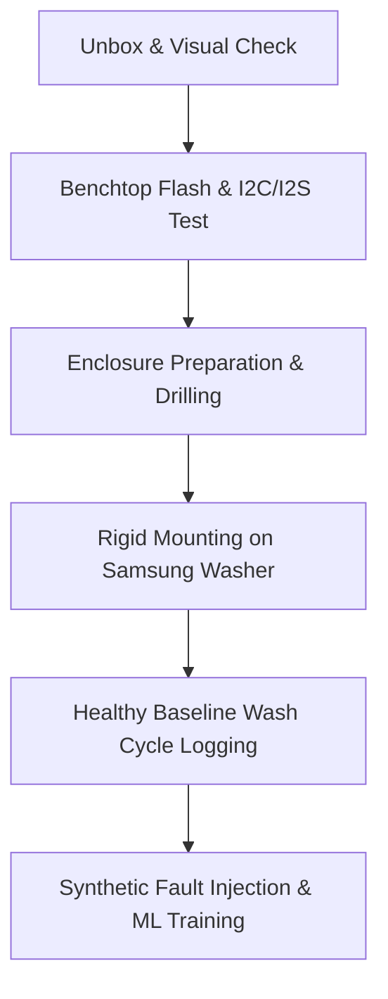

# Multimodal IoT Predictive Maintenance (PdM) Blueprint & Setup Guide
**Project:** Anomaly Vibration & Acoustic Detection for Samsung WW10TP44DSX/FQ 10kg Washer  
**Academic Alignment:** Multimodal Machine Learning for Rotating Machinery Fault & Misalignment Detection  
**Target Platform:** ESP32 (30-Pin) + MPU-6050 (I2C) + INMP441 (I2S)  

---

## 1. Complete Bill of Materials (BOM) & Purchasing List

| Item # | Component | Shop (Shopee MY) | Selected Variant | Price (MYR) | Hardware Role |
| :---: | :--- | :--- | :--- | :---: | :--- |
| **1** | **NodeMCU ESP32 Dev Board** | Robotedu.my | `ESP32 Board + USB` (30-Pin) | RM 32.90 | Main dual-core microcontroller (240MHz, Wi-Fi/BLE, I2C/I2S buses). |
| **2** | **ESP32 Screw Terminal Shield** | MakerHub MY | `ESP32 EXPANSION BRD` (30-Pin) | RM 8.46 | Secure vibration-proof interface for sensor jumper wires. |
| **3** | **MPU-6050 Accelerometer / Gyro** | ElectricA Ecom | `Soldered` (Pre-soldered headers) | RM 21.99 | High-speed 3-axis vibration & acceleration measurement ($\pm 16g$). |
| **4** | **INMP441 MEMS Microphone** | ElectricA Ecom | `Soldered` (Pre-soldered headers) | RM 25.99 | Studio-grade digital I2S acoustic sensor for mechanical audio emission. |
| **5** | **Dupont Jumper Wires (40pcs)** | MakerHub MY | `DUPONT WIRE M-F 20CM` | RM 3.20 | Connects sensor headers (F) into the screw shield terminals (M). |
| **6** | **Waterproof ABS Project Box** | baba168.my | `158x90x60mm` | RM 16.30 | IP65 weather-sealed enclosure to mount hardware rigidly on chassis. |
| **7** | **PG7 Cable Glands (5pcs)** | CASSETECH | `WHITE PG7` | RM 2.50 | Creates an airtight, waterproof rubber seal around the USB power wire. |
| **8** | **3M Original VHB Mounting Tape** | 3M shop | `2.5cm x 3m` (0.8mm thick) | RM 14.61 | Ultra-stiff viscoelastic bond to transmit high-frequency vibration. |
| **Total** | | | | **~RM 125.95** | |

---

## 2. Technical Component Breakdown: What Each Part Does

### 1. NodeMCU ESP32 (30-Pin Dev Board) + USB Cable
* **What it does:** The central brain of the IoT system. Features a 32-bit Xtensa dual-core processor clocked at 240MHz with 520KB SRAM and onboard Wi-Fi / Bluetooth.
* **Why this exact variant:** It is equipped with dedicated hardware peripherals: an **I2C controller** (for the vibration sensor) and an **I2S DMA controller** (Direct Memory Access for streaming digital audio without stalling the CPU). Includes the USB-to-UART data cable for flashing firmware and providing 5V DC power.

### 2. ESP32 30-Pin Screw Terminal Expansion Shield
* **What it does:** Breaks out all 30 pins of the ESP32 into industrial screw terminal blocks.
* **Why it is critical:** Normal female jumper wires plugged directly into development board headers rattle loose within hours when subjected to 1400 RPM spin-cycle vibrations. Screw terminals clamp the wires firmly in place.

### 3. MPU-6050 6-DOF IMU (Accelerometer & Gyroscope - Pre-Soldered)
* **What it does:** Contains a 3-axis MEMS accelerometer and a 3-axis angular velocity gyroscope with an internal 16-bit ADC.
* **How it is configured:** Configured via I2C at $200\text{ Hz}$ sampling rate with full-scale range set to $\pm 16g$. During heavy spin cycles on your Samsung washer, centrifugal acceleration spikes well above $2g$; setting the range to $\pm 16g$ prevents signal clipping.

### 4. INMP441 Omnidirectional MEMS Microphone (Pre-Soldered)
* **What it does:** Captures acoustic emissions from rotating bearings, motor whine, and friction.
* **Why digital I2S over analog:** Traditional analog microphones (like the MAX4466) pick up electromagnetic noise from the washing machine inverter motor and ESP32 Wi-Fi antenna. The INMP441 digitizes audio internally and transmits clean 24-bit PCM audio over the I2S digital bus.

### 5. 40pcs Dupont Wires (Male-to-Female, 20cm)
* **What it does:** Provides the physical wiring bridge. The female end plugs snugly onto the sensor pins, while the male end is stripped or inserted directly into the expansion board's screw clamp.

### 6. ABS Waterproof Enclosure (158x90x60mm)
* **What it does:** Houses the ESP32, expansion board, and sensors. Protects the electronics from outdoor rain, splash, and high-humidity laundry steam.
* **Structural role:** The flat, rigid ABS base serves as the direct mechanical transmitter from the washer steel frame into the MPU-6050.

### 7. PG7 Nylon Waterproof Cable Glands
* **What it does:** Threaded waterproof feedthrough collar with internal rubber compression gasket. Clamps down around the USB power cord to stop water and insects from entering the box.

### 8. 3M Original VHB Double-Sided Tape (2.5cm x 3m)
* **What it does:** Bonds the ABS enclosure to the washing machine chassis.
* **Acoustic/Vibration Importance:** Standard foam tape acts like an acoustic shock absorber, filtering out high-frequency vibrations. 3M Very High Bond (VHB) acrylic foam provides near-solid structural coupling so high-frequency harmonic signals pass cleanly into the accelerometer.

---

## 3. Pin-by-Pin Wiring Diagram

```
                     +---------------------------------------+
                     |         NodeMCU ESP32 (30-Pin)        |
                     |             on Screw Shield           |
                     +---------------------------------------+
                               |                   |
            [ I2C Bus ]        |                   |        [ I2S Bus ]
                               v                   v
                     +-------------------+   +--------------------+
                     | MPU-6050 (Vib)    |   | INMP441 (Acoustic) |
                     +-------------------+   +--------------------+
                     | VCC  <-> 3V3      |   | VDD  <-> 3V3       |
                     | GND  <-> GND      |   | GND  <-> GND       |
                     | SCL  <-> GPIO 22  |   | SCK  <-> GPIO 33   |
                     | SDA  <-> GPIO 21  |   | WS   <-> GPIO 25   |
                     | AD0  <-> GND      |   | SD   <-> GPIO 32   |
                     | INT  <-> (Unused) |   | L/R  <-> GND       |
                     +-------------------+   +--------------------+
```

### Complete Pin Connection Table

| Sensor | Sensor Pin | ESP32 Pin on Screw Shield | Signal / Protocol | Wire Color Suggestion | Purpose |
| :--- | :--- | :--- | :--- | :--- | :--- |
| **MPU-6050** | **VCC** | **3V3** | Power (3.3V DC) | Red | Sensor Power Supply |
| **MPU-6050** | **GND** | **GND** | Ground (0V) | Black | Common Ground |
| **MPU-6050** | **SCL** | **GPIO 22** | I2C Serial Clock | Yellow | I2C Clock Line |
| **MPU-6050** | **SDA** | **GPIO 21** | I2C Serial Data | Green | I2C Data Line |
| **MPU-6050** | **AD0** | **GND** | Address Select | Blue | Locks I2C Address to `0x68` |
| **INMP441** | **VDD** | **3V3** | Power (3.3V DC) | Red | Digital Mic Power |
| **INMP441** | **GND** | **GND** | Ground (0V) | Black | Digital Mic Ground |
| **INMP441** | **SCK** | **GPIO 33** | I2S Serial Clock (BCLK)| Orange | Continuous Bit Clock |
| **INMP441** | **WS** | **GPIO 25** | I2S Word Select (LRCLK)| White | Frame Clock (Left/Right) |
| **INMP441** | **SD** | **GPIO 32** | I2S Serial Data (DIN) | Gray | Serial Audio Data stream |
| **INMP441** | **L/R** | **GND** | Channel Mode | Purple | Pull down to select Left Channel |

> [!IMPORTANT]
> Both the MPU-6050 and INMP441 must share the **same 3.3V (3V3) and GND rail** on the ESP32. The screw expansion shield provides multiple 3.3V and GND terminals, making this parallel connection very simple.

---

## 4. What to Do Once Everything Arrives (Step-by-Step Checklist)



### Phase 1: Benchtop Verification (Before Installing)
1. **Board Seat Check:** Align the 30-pin ESP32 into the expansion shield. Double check pin numbers (`D21`, `D22`, `3V3`, `GND`) before screwing anything.
2. **Firmware Test (Blink & I2C Scanner):**
   * Plug the USB cable into your laptop.
   * In Arduino IDE, select board `ESP32 Dev Module` and flash a basic I2C Scanner sketch.
   * Verify serial output displays: `I2C device found at address 0x68` (confirms MPU-6050 is working).
3. **I2S Microphone Stream Test:**
   * Flash an I2S read script and monitor raw audio waveform in Arduino Serial Plotter. Speak or tap near the mic to verify dynamic amplitude response.

### Phase 2: Enclosure Assembly & Weatherproofing
1. **Cable Gland Entry:** Drill one $12\text{ mm}$ hole on the bottom side wall of the ABS box. Insert the PG7 gland and tighten the locknut.
2. **Microphone Port:** Drill a tiny $1.5 - 2.0\text{ mm}$ pinhole in the **lower part of a side wall** (not the bottom face, which gets covered by the VHB tape), lined up with the sound port on the INMP441 board. See Section 5 for details.
3. **Internal Mounting:** Use a small strip of 3M VHB tape to firmly anchor the MPU-6050 flat against the **inside floor** of the ABS box. *(Do not let it float loose on wires!)*
4. **Wire Routing:** Feed the USB cable through the PG7 gland and tighten the outer rubber gasket.

### Phase 3: Mounting onto the Samsung Washer
1. **Surface Prep:** Clean the mounting area on the washing machine using isopropyl alcohol or a damp cloth followed by a dry wipe.
2. **Location:** Mount the enclosure on the **top-rear metal casing** or **upper back metal panel** near the suspension anchors.
3. **Coupling:** Apply 3M VHB tape along the entire bottom surface of the ABS enclosure and press firmly for 30 seconds against the washer chassis.

### Phase 4: Data Collection & Experiments
1. **Healthy Baseline Collection:** Run a standard Daily Wash / Cotton cycle with 3–4kg of mixed clothes. Stream or log raw $X, Y, Z$ acceleration and audio RMS across all phases (Agitation $\rightarrow$ Rinse $\rightarrow$ $1400\text{ RPM}$ High Spin).
2. **Synthetic Fault Injection 1 (Unbalance):** Run a spin cycle with 1 single heavy wet bath towel or soaked denim jacket.
3. **Synthetic Fault Injection 2 (Loose Footing):** Rotate one front rubber foot counter-clockwise by 2 turns so the washer rocks slightly during spin ramp-up.
4. **ML Model Training:** Extract rolling time-domain features (RMS, Kurtosis, Peak-to-Peak) and frequency-domain features (FFT harmonics at $1\times$ and $2\times\text{ RPM}$). Train an **Isolation Forest** or **Autoencoder** to score anomalies in real time!

---

## 5. Enclosure Drilling Guide: 12 mm Gland Hole & Microphone Port

### Why 12 mm?
The hole holds the **PG7 cable gland**, which lets the USB power cable enter the box without letting water in. PG7 has an outer thread diameter of about 12.5 mm, so drill **12 mm** and open it very slightly with a round file or the side of the bit. The gland should thread in with light resistance and the locknut should sit flat against the wall. If the hole is too loose, the gasket cannot seal.

### How to drill ABS plastic
1. **Empty the box.** Take the electronics out so plastic shavings do not land on them.
2. **Mark and dent.** Mark the spot with a pencil and make a small dent with a nail or centre punch so the bit does not wander.
3. **Step up gradually.** Drill a 3 mm pilot hole, then 6 mm, then 12 mm. A **step (cone) drill bit** is better if available, as it cuts a clean round hole in thin plastic in one pass.
4. **Low speed, light pressure.** Clamp or firmly hold the box. ABS is soft but cracks or grabs if you rush a large bit.
5. **Deburr.** Clean the hole edge with a knife or sandpaper so the gasket sits flat.

### Where to put the hole
* Use a **side or bottom wall that will not face the washer**, since the box sits flush on the chassis.
* Let the cable leave in a small downward **drip loop** so rain drips off the bottom of the loop instead of running along the cable into the gland.

> [!WARNING]
> **Check 1: Will the USB plug fit through the gland?** A PG7 gland grips cables of roughly 3 to 6.5 mm, but the rubber insert opening can be tight for a plug. Micro-USB usually passes, but USB-C is wider and may not. **Test your connector through the gland before drilling.** If it will not pass, feed the bare cable through and connect inside the box, or use a cable with a smaller plug.

> [!WARNING]
> **Check 2: Microphone pinhole position.** The VHB tape covers the entire bottom face of the box, which would block a hole drilled there. Drill the 1.5 to 2 mm pinhole in the **lower part of a side wall**, lined up with the INMP441 sound port, facing sideways or down so rain cannot run in. Check where the port sits on your board before drilling.

---

## 6. Firmware Notes Before Real Data Collection

1. **Raise the MPU-6050 filter bandwidth.** `02_multimodal_telemetry_test.ino` sets `MPU6050_BAND_44_HZ`. At 1400 RPM the spin fundamental is about 23 Hz and the 2x harmonic is about 47 Hz, which a 44 Hz filter attenuates. Change it to `MPU6050_BAND_94_HZ` or `MPU6050_BAND_184_HZ`.
2. **Use a fixed sample rate.** The loop blocks on `i2s_read` and also uses `delay(10)`, so the rate is irregular and likely below 100 Hz. Fine for bench tests, but for FFT features use a timed sampling loop or a separate audio task so the rate is a stable 200 Hz.
